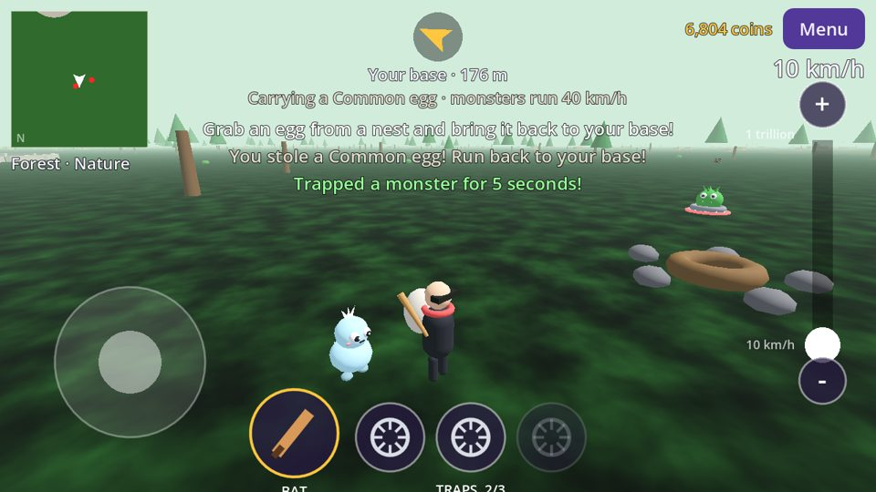
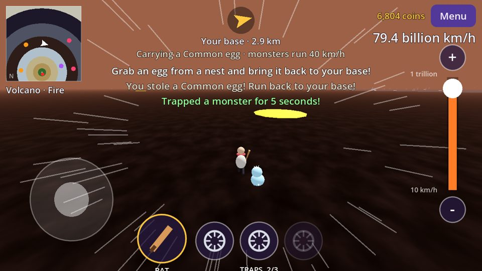
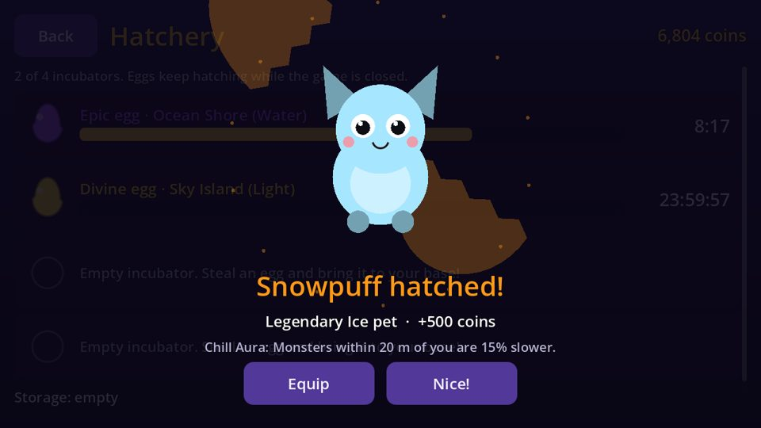
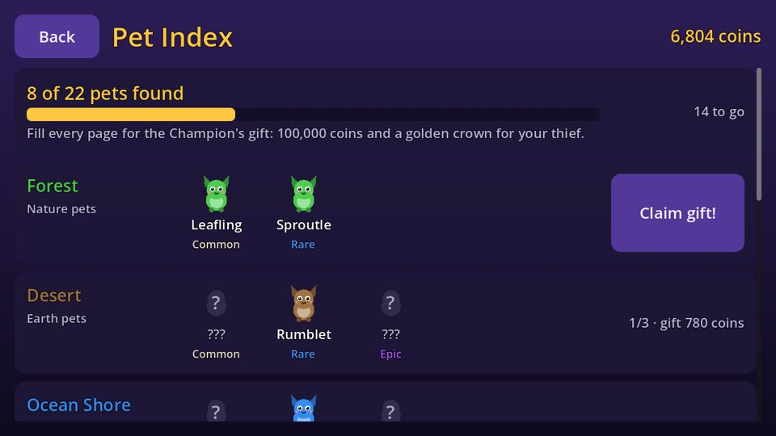
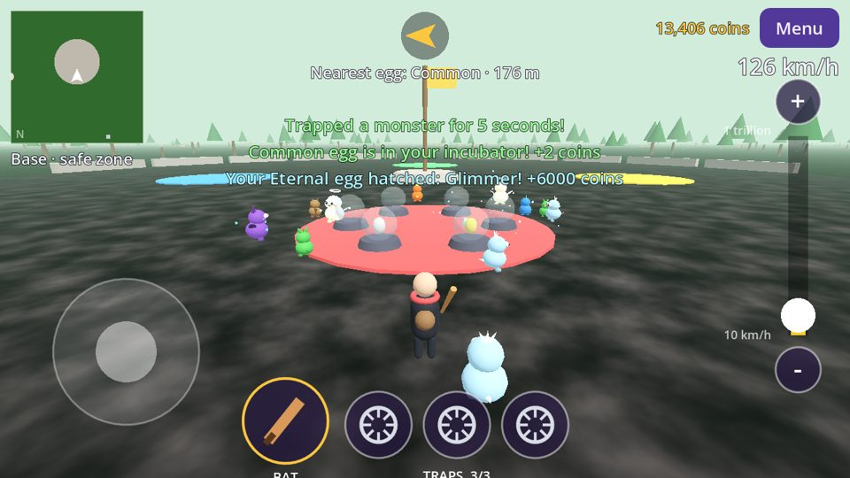
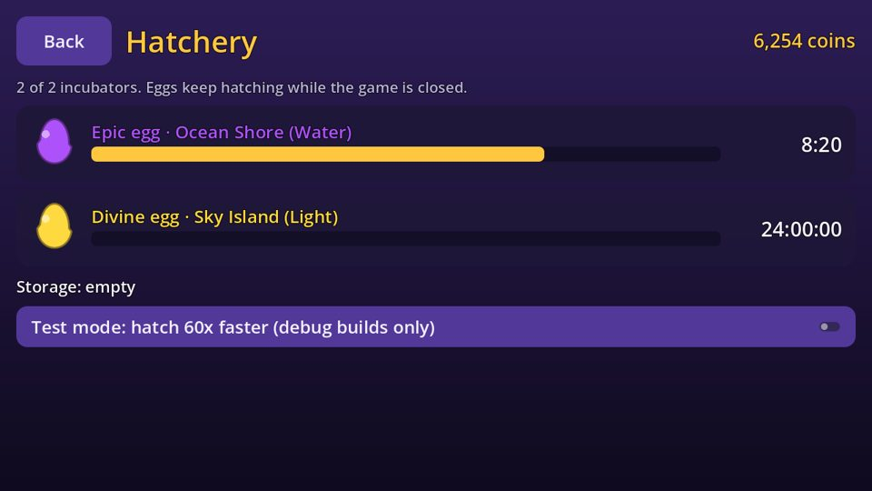

# Steal an Egg

A 3D mobile game made with [Godot 4.7](https://godotengine.org/). Steal monster eggs from eight elemental biomes, outrun or trap the monsters that chase you, and carry the eggs home to hatch them into pets.

| | |
|---|---|
|  |  |
|  |  |
|  |  |

## How to play

- **The world** is a big circle. Your **base** is in the middle (monsters can't enter it). Eight biomes ring it, each farther out and more dangerous than the last:

  | # | Biome | Element | Eggs found there | Monster speed |
  |---|---|---|---|---|
  | 1 | Forest | Nature | mostly Common | 40 km/h |
  | 2 | Desert | Earth | mostly Rare | 2,000 km/h |
  | 3 | Ocean Shore | Water | mostly Epic | 100,000 km/h |
  | 4 | Glacier | Ice | mostly Legendary | 10 million km/h |
  | 5 | Volcano | Fire | mostly Mythical | 1 billion km/h |
  | 6 | Storm Peaks | Lightning | mostly Secret | 50 billion km/h |
  | 7 | Shadow Swamp | Dark | mostly Eternal | 1.5 trillion km/h |
  | 8 | Sky Island | Light | mostly Divine | 3 trillion km/h |

  Each biome has three nests. An egg is usually its biome's rarity, sometimes one rarer or one more common. Each egg has a light beam so you can spot it from far away.
- **Stealing:** run over a nest to grab the egg. Its guard monsters climb out of the ground and chase you. Monster speed depends on the egg's rarity (see the table).
- **Speed:** the slider on the right goes from **10 km/h to 1 trillion km/h**. You can outrun a Common egg's monsters easily. Monsters guarding the rarest eggs are faster than your top speed, so you'll need your bat and traps.
- **Baseball bat and 3 traps** (bottom of the screen):
  - **Bat:** hits whatever is in front of you.
    - Monsters are knocked back and stunned.
    - A rival thief is knocked back and drops their egg.
  - **Traps:** tap a trap to drop it behind you, or drag it onto the ground to place it there.
    - A trap holds a monster **or a rival thief** for **5 seconds**, and a trapped thief drops their egg.
    - Your own traps never catch you.
    - You get 3 per trip, and they refill at your base.
- **Caught:** if a monster catches you, your egg stays exactly where you were caught. You fall from the sky into the **previous biome** (the base, if you were in the Forest) and have to run back for it. An arrow at the top of the screen points the way.
- **Hatching:** bring the egg into your base and it goes into an incubator. The timer runs in real time, even while the game is closed. You start with 2 incubators and can buy up to 6. Extra eggs wait in storage (up to 10).

  | Egg | Hatch time | Coins |
  |---|---|---|
  | Common | 1 min | 10 |
  | Rare | 10 min | 50 |
  | Epic | 30 min | 200 |
  | Legendary | 45 min | 500 |
  | Mythical | 55 min | 1,000 |
  | Secret | 1 hour | 2,500 |
  | Eternal | 2 hours | 6,000 |
  | Divine | 1 day | 50,000 |

- **Pets:** when an egg hatches, it cracks open and the pet pops out. You see it in the incubator if you're at your base, and as a hatching animation on the menu or Hatchery screen. Each biome and rarity hatches its own pet (for example Leafling for a Common Forest egg, Sproutle for a Rare one). Your pets wander around your base. Equip one and it follows you, with a perk that gets stronger with rarity:

  | Element | Perk |
  |---|---|
  | Nature | Slows on you are weaker |
  | Earth | Your bat stuns monsters for longer |
  | Water | Builds you a new trap while you are out |
  | Ice | Monsters near you are slowed |
  | Fire | Now and then stuns monsters around you |
  | Lightning | Your bat recharges faster |
  | Dark | Monsters wake up later after you grab an egg |
  | Light | Shows every egg on your map and blocks blinding flashes |

- **Monsters** also use their element's power against you:

  | Element | Power |
  |---|---|
  | Nature | Vines slow you |
  | Earth | Bat stuns last half as long |
  | Water | Dashes forward |
  | Ice | Makes the ground slippery |
  | Fire | Burning ground slows you |
  | Lightning | Teleports closer to you |
  | Dark | Nearly invisible until close |
  | Light | Blinding flash |

- **Pet Index:** a page for each biome, with a spot for every pet you can hatch there (22 in all). Fill a page and claim its gift: three times the coins those pets gave when they hatched. Fill the whole Index for the **Champion's gift**: 100,000 coins and a golden crown your thief wears, which other players can see too.
- **Shop:** spend coins on more incubators and bat upgrades.

### Playing together on the same Wi-Fi

1. One phone taps **Host Wi-Fi game**. Everyone else on the same Wi-Fi taps **Join Wi-Fi game**.
2. Joiners pick the host from the list. If the host doesn't show up, type the address shown on the host's screen. The game remembers the last address you typed.
3. The host taps **Start game**. Up to 4 thieves can play. Players can also join after the game has started.

Everyone hunts eggs in the same world. Trap a rival who is carrying an egg (or hit them with the bat) and the egg is yours to grab. Each player's hatchery, pets and coins are saved on their own phone.

If a phone loses the connection (weak Wi-Fi, the screen turning off, switching apps), it goes to the join screen and rejoins the same game by itself. Any egg it was carrying is dropped where it was. When the host ends the game, everyone returns to the menu.

### Controls

| | Phone | Keyboard (desktop testing) |
|---|---|---|
| Move | Joystick (bottom left) | WASD / arrow keys |
| Speed | Slider and + / − (right) | E / Q |
| Bat | Bat button (bottom) | Space |
| Trap | Tap or drag a trap (bottom) | T |
| Turn the camera | Drag anywhere else | — |

## Project layout

| Folder | What's in it |
|---|---|
| `core/` | Game rules and tables with no scene code: rarities, biomes, elements, speed scale, world layout, hit tests, hatchery timers, loot, Pet Index |
| `autoload/` | `SaveGame` (progress on this phone) and `Net` (solo, host, join, finding hosts on the Wi-Fi) |
| `game/` | The 3D world: thief, monsters, eggs, traps, pets, camera, and the world rules (`world.gd`) |
| `ui/` | HUD with touch controls and map, plus the menu, lobby, hatchery, pets and shop screens |
| `scenes/` | Small scene files that load the scripts above |
| `tests/` | Headless tests, a script checker, a two-process network test and a screenshot tool |

All balancing numbers are in `core/game_data.gd`. The art is placeholder shapes built in code, ready to be swapped for real models.

The phone that hosts (or the only phone, in solo play) runs the rules: monsters, eggs, traps, hits and catches. Each phone moves its own thief. Position updates go out 20 times a second; egg, monster and trap changes are sent when they happen.

**About speed:** the km/h on screen follow a logarithmic scale from 10 to 1 trillion. Real movement follows the same curve but stays within 3–600 m/s, so the 8 km world stays playable and the engine's position maths stays accurate.

## Running and testing

Open this folder in Godot 4.7, or use the command line:

```sh
godot --path .                                                 # play
godot --headless --path . --import                             # first time: import assets
godot --headless --path . res://tests/check_scripts.tscn       # every script compiles
godot --headless --path . res://tests/test_runner.tscn         # unit and gameplay tests
tests/run_net_smoke.sh godot                                   # host + client over the network
```

The **Build Steal an Egg** GitHub Actions workflow (`.github/workflows/build-steal-an-egg.yml`) runs all of these. It then builds a debug APK, which you can download from the workflow run's **Artifacts** and install on an Android phone.

Debug builds have a **Test mode** switch on the Hatchery screen that hatches eggs 60x faster.

## Before publishing

- The debug APK is signed with a throwaway key. For Google Play, set a release keystore and export a release build (AAB).
- Replace the placeholder shapes with real models and add sound.
- The README screenshots come from `tests/screenshots.tscn`. On Linux, regenerate them with `xvfb-run godot --path . --rendering-method gl_compatibility res://tests/screenshots.tscn -- --out=/tmp/shots`.
- Hatch notifications while the app is closed would need an Android notifications plugin.
